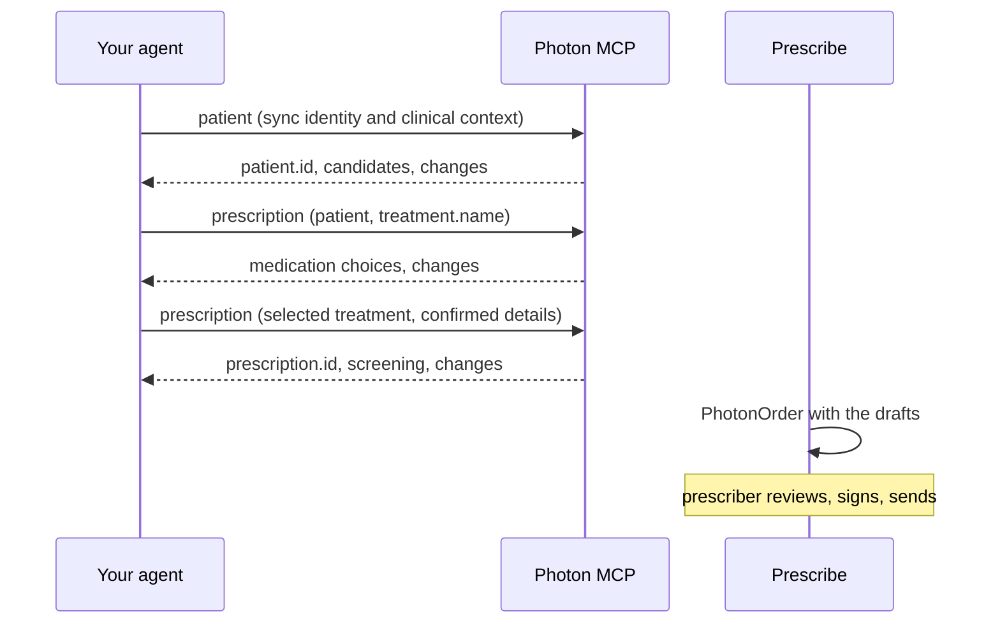

<Note>
  MCP is open to every Neutron account. In production, it's in **private preview**: see [client approval](/network/mcp/connect#cimd-and-client-approval) or contact [support@photon.health](mailto:support@photon.health).
</Note>

Your clinical agent reads the encounter, syncs the patient, searches medications and prepares draft prescriptions. A prescriber then opens the drafts in Prescribe to review, sign and submit the order.



## 1. Connect the agent

Point your agent's MCP client at the Neutron server:

```text
https://ai.neutron.health
```

The agent authenticates like any other caller. A backend agent uses a [machine token](/authentication#machine-tokens). An agent that runs in a prescriber's MCP client, such as Claude or ChatGPT, signs in as that prescriber. See [Connect a client](/network/mcp/connect).

## 2. Sync the patient and draft prescriptions

Use `patient` to sync the patient: find, create or update from the encounter context. Match an existing patient before creating a new record. Supply known allergies, medication history and diagnoses when available.

Then call `prescription` with `treatment.name` and the resolved `patient.id`. Search before asking for missing dosage, directions or dispense details. If identity is unresolved, you can search without a patient and attach one later.

Use returned choices and `changes.unapplied` to complete the draft. Keep any returned prescription ID and resend pending fields when resolving a choice. Show draft defaults and screening to the prescriber for review; don't invent missing clinical details or treat a medication match as a complete screen.

If the encounter changes, update the patient and prescription as needed, then obtain a fresh review. See [Prescribing tools](/network/mcp/prescribing) for input examples and continuation rules.

## 3. Hand the drafts to a prescriber

Pass the patient and the draft prescriptions to Prescribe. The prescriber sees each draft with its screening, signs, and sends.

<CodeGroup>

```tsx React
<PhotonOrder
  order={{
    patient: { id: patientId },
    prescriptions: { add: draftIds.map((id) => ({ id })) },
  }}
  fixed
  onSent={onDone}
/>
```

```ts iframe
// ph = photon({ environment: "neutron", auth: { clientId: "YOUR_CLIENT_ID" } })
iframe.src = ph.order.frame({
  patient: { id: patientId },
  prescriptions: { add: draftIds.map((id) => ({ id })) },
});
```

</CodeGroup>

To hand over a single ID, call the MCP [`order` tool](/network/mcp/prescribing#order) with the patient and prescription IDs, then open the returned order in Prescribe. The call may resume an existing draft, so review every prescription it returns.

## Sending from the agent

An agent acting for a signed-in prescriber can use the same MCP tools for finalization after explicit review and approval. `prescription` signs reviewed content using its content hash. `order` with only `id` and `state: "SUBMITTED"` requests submission. Photon enforces authorization and signing requirements.

Don't ask for a pharmacy unless the user explicitly requests a destination. Read back with `orders` and distinguish submission from pharmacy receipt. See [Sign a reviewed prescription](/network/mcp/prescribing#sign-a-reviewed-prescription) and [Submit the reviewed order](/network/mcp/prescribing#submit-the-reviewed-order).
