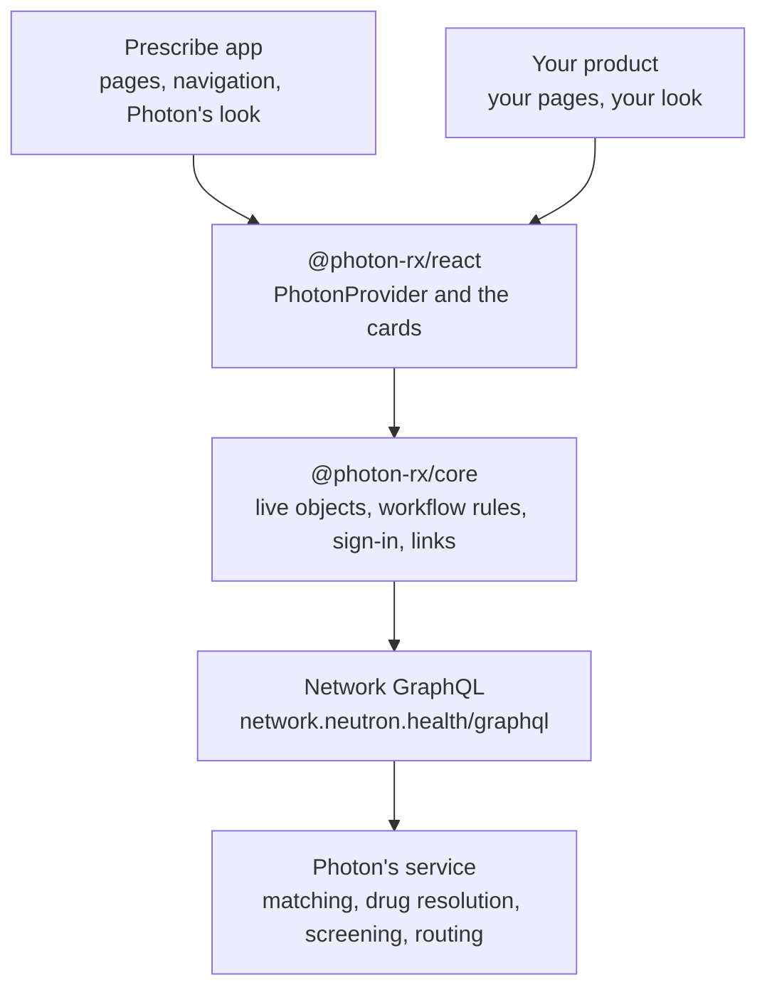

The [Prescribe app](/prescribe/app) at `rx.neutron.health` is built from the same parts you embed. Each page is one of the [React components](/prescribe/embed/react), the components run on the [JavaScript client](/prescribe/embed/javascript), and the client calls the same [Network](/network/overview) API your backend does. Prescribe has no private API, so anything the app does, your product can do too.

| Layer | Package | What it does |
| --- | --- | --- |
| **App** | The Prescribe app | Pages, navigation and Photon's look. Nothing else. |
| **Components** | `@photon-rx/react` | The cards, rendered through building blocks you can replace |
| **Client** | `@photon-rx/core` | Sign-in, tokens, the API calls and the workflow rules |
| **API** | [Network](/network/overview) | Three upserts, `patient`, `prescription` and `order`, over GraphQL |

Each layer uses only the one below it. The workflow rules live in the client, so the app, the iframe and your React page all behave the same.

## The app

The Prescribe app is a thin shell around the cards. Each page renders one card and gives it the records in the URL:

| Page | Renders |
| --- | --- |
| `/order` | `<PhotonOrder />` |
| `/patient` | `<PhotonPatient />` |
| `/prescription` | `<PhotonPrescription />` |

The app adds only what a page needs around a card: the navigation bar, reading records from the URL, and Photon's design system, which it passes to the cards as their [building blocks](/prescribe/embed/styling). The [iframe](/prescribe/embed/iframe) is the same page at `/<flow>/embed`, without the navigation bar.

So a [deep link](/prescribe/app/deep-links), an iframe and `<PhotonOrder />` in your page all run the same component on the same records. A draft started in one opens in the others.

## The components

`@photon-rx/react` has the three cards and `PhotonProvider`. The cards hold no prescribing logic. Each one binds to a live object from the client, renders its state, and calls its methods when the prescriber acts. Only screen state, such as which prescription is focused, stays in the card.

The cards render only through building blocks (`Button`, `Input`, `Card`, `Alert` and the rest). The Prescribe app passes Photon's. Your app passes its own, or uses the stock ones, which inherit your page's styles. See [Styling](/prescribe/embed/styling).

The cards have no page chrome: no header, no fixed bars, no viewport breakpoints. They size to their container, so the app places them in a page and you can place them in a page, a dialog or a side panel.

## The client

`@photon-rx/core` is where the work happens. It has no dependencies and runs in browsers and Node.

- **Live objects.** Each patient, prescription and order is one object per client, with `state`, `status` and `subscribe`. Every card that shows a record shares its object, so an edit in one card shows in all of them.
- **Get, sync and update.** Each object calls its record's upsert in one of the [three ways](/architecture#get-sync-and-update). A card given an id gets, given fields syncs, and given both updates.
- **Workflow rules.** A prescription without a patient only looks a drug up, and never creates a draft. The newest response wins. Signing waits for saves in flight. An order is ready to send only when its patient is found, every prescription is signed, and nothing is still saving.
- **Changes.** Every response says what Photon applied and what it didn't. When Photon offers options, the client never picks one unless Photon is sure of it. See [Changes and choices](/network/changes).
- **Links.** `url()` makes a deep link and `frame()` makes an iframe URL for any record.

Photon's service still makes the decisions: matching, drug resolution and screening. The client sends what's known and reads back what Photon decided.

## Sign-in

The client signs the prescriber in by itself. Give it an Application `client_id`, and it runs Auth0's authorization code flow with PKCE at `auth.neutron.health`, using only the browser's own crypto, `fetch` and storage. The prescriber picks their organization, and the client keeps their token renewed. Every request carries that user token, so the prescriber can sign.

| Where | Signs in with |
| --- | --- |
| Prescribe app | Its own Application `client_id` |
| React components | Your `client_id`, through `<PhotonProvider clientId="…">` |
| iframe | Your `client_id`, which `frame()` puts in the URL. Sign-in opens a popup. |
| JavaScript client | Your `client_id`, or your own tokens with `auth: { getToken }` |

Sign-in never redirects on its own. On load, the client finishes a sign-in returning from Photon or renews a stored session. Otherwise, the first card shows **Sign in to Photon**, and the prescriber clicks it.

The access token stays in the page's memory. The page's `localStorage` keeps only the refresh token and the prescriber's name, email and organization, so a reload or a new tab signs back in with a refresh. Auth0 rotates the refresh token on every use and revokes it as soon as an old one is used again. The page's tabs take turns refreshing, so they never trip that. Without a refresh token, nothing is stored, and the prescriber signs in again after a reload.

Machine tokens can draft but can't sign. That's why signing always happens in a browser, with a prescriber's token. See [Authentication](/authentication).

## The same Network API

There's no proxy and no Prescribe API in between. The browser calls `https://network.neutron.health/graphql` directly with the prescriber's token, using the same three mutations your backend calls with a machine token:

| Card | Calls |
| --- | --- |
| `PhotonPatient` | [`patient`](/network/patient) |
| `PhotonPrescription` | [`prescription`](/network/prescription) |
| `PhotonOrder` | [`order`](/network/order), plus `patient` and `prescription` for its parts |

Photon decides the same way whoever calls it. A patient your backend synced is the one the card finds, and an order your backend drafted is the one the prescriber opens. The `changes` the cards act on are the ones your backend reads.

## See it in /integrate

[`rx.neutron.health/integrate`](https://rx.neutron.health/integrate) is a debugger for every layer. Choose a flow and how it's used, give it records, and sign in with your Neutron account. It renders the flow beside the code for that setup, ready to copy, and keeps the setup in the URL, so you can share or bookmark it.

With the React components, it shows each layer as you prescribe:

| Panel | Shows | Layer |
| --- | --- | --- |
| **Events** | Each callback (`onPatient`, `onOrder`, `onSent`…) as it fires | Components |
| **Objects** | The live objects the card is bound to, with their state as it changes | Client |
| **Requests** | Every Network request: the operation, its variables, the response and how long it took | API |

With the iframe, it shows each message the iframe posts. With the JavaScript client, it runs the calls and shows the objects' changes as they happen.

<CardGroup cols={2}>
  <Card title="React components" icon="react" iconType="brands" href="https://rx.neutron.health/integrate/order">
    `<PhotonOrder />` with its events, objects and requests
  </Card>
  <Card title="iframe" icon="browser" href="https://rx.neutron.health/integrate/order/embed">
    The iframe, its host code and the messages it posts
  </Card>
  <Card title="Deep link" icon="link" href="https://rx.neutron.health/integrate/order/link">
    A deep link for the records you give it, and the code that makes it
  </Card>
  <Card title="JavaScript client" icon="js" iconType="brands" href="https://rx.neutron.health/integrate/order/js">
    The live objects in a page with no framework, run beside their code
  </Card>
</CardGroup>

<Note>
  /integrate runs against the Neutron sandbox. The patients and prescriptions you create there are real records in your sandbox organization.
</Note>
